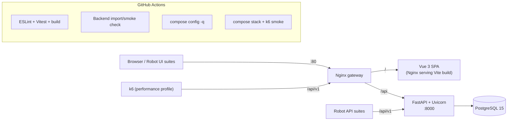

# Inventory System Pro

[](https://github.com/fanfanmyid/inventory-system-pro/actions/workflows/ci.yml)

Inventory System Pro is a full-stack inventory & sales management platform built with **FastAPI** (backend), **Vue 3 + Vite** (frontend), and a **PostgreSQL** datastore. The project ships with a layered test strategy — **Vitest** unit tests, **Robot Framework** API BDD and Selenium UI suites, and **k6** performance scripts — plus **GitHub Actions CI**, containerized environments via **Docker Compose**, and seed scripts to bootstrap demo data quickly.

---

## Table of Contents
1. [Highlights](#highlights)
2. [Tech Stack](#tech-stack)
3. [Architecture Overview](#architecture-overview)
4. [Project Structure](#project-structure)
5. [Prerequisites](#prerequisites)
6. [Getting Started](#getting-started)
7. [Environment Configuration](#environment-configuration)
8. [Running the Stack](#running-the-stack)
9. [Test Strategy](#test-strategy)
10. [Continuous Integration](#continuous-integration)
11. [Automation Testing](#automation-testing)
12. [Performance Testing (k6)](#performance-testing-k6)
13. [Router Publishing](#router-publishing)
14. [Landing Page](#landing-page)
15. [Useful Commands](#useful-commands)
16. [Troubleshooting](#troubleshooting)
17. [Portfolio Checklist](#portfolio-checklist)
18. [Contributing](#contributing)

---

## Highlights

- **Production-like workflows**: Containerized FastAPI, PostgreSQL, and Vite/Nginx mirror a realistic deployment topology.
- **Layered automated confidence**: Vitest unit tests, Robot Framework REST BDD flows, Selenium UI journeys, and k6 performance checks — each layer runs where it belongs (CI vs. local stack).
- **CI on every push**: GitHub Actions lints and unit-tests the frontend, smoke-checks the backend app, validates the Compose file, and runs a k6 smoke test against a freshly built stack.
- **Service layering**: CRUD, services, and schemas clearly separate persistence, business logic, and IO.
- **Batteries included**: Seed scripts, tagged test suites, and `.env` templates shrink onboarding time to minutes.
- **Portfolio ready**: Clean documentation, deterministic commands, and automated testing make this project easy to showcase.

## Tech Stack

| Layer | Technologies |
| --- | --- |
| **API** | FastAPI, SQLAlchemy, Pydantic, Alembic |
| **Data** | PostgreSQL 15 (Alpine), SQL migrations |
| **Frontend** | Vue 3, Vite, Pinia, Vue Router, Bootstrap styles |
| **Automation** | Robot Framework, RequestsLibrary, SeleniumLibrary, Vitest, @vue/test-utils |
| **Performance** | k6 (smoke / load / write-heavy profiles) |
| **DevOps** | GitHub Actions, Docker Compose, Uvicorn, Nginx, seed scripts |

## Architecture Overview

- **Backend**: FastAPI application exposing REST APIs for authentication, product management, transactions, and sales. SQLAlchemy models, Alembic migrations, and a service layer encapsulate business logic.
- **Database**: PostgreSQL 15 (Alpine) container, with Alembic handling schema evolution.
- **Frontend**: Vue 3 SPA (Vite tooling) delivering dashboards for inventory & sales, including rich UX features (filters, modals, history tables).
- **Gateway**: Nginx routes `/` to the Vue build and `/api` to FastAPI — the only internet-facing service.
- **Automation**: Vitest unit tests in CI; Robot Framework API/UI suites and k6 scripts against the running stack.



---

## Project Structure

```
inventory-system-pro/
├── .github/workflows/ci.yml  # GitHub Actions CI pipeline
├── backend/                  # FastAPI application
│   ├── app/                  # Core modules, routers, services, schemas
│   ├── scripts/              # Entrypoint, seed & CI smoke-check utilities
│   ├── requirements.txt
│   └── Dockerfile
├── frontend/                 # Vue 3 + Vite SPA
│   ├── src/                  # Views, components, stores, Vitest specs
│   ├── package.json
│   └── Dockerfile
├── deploy/nginx/             # Gateway configuration
├── tests/
│   ├── robot/
│   │   ├── resources/        # Shared keywords & locators
│   │   └── suites/           # Backend API & frontend UI Robot suites
│   └── performance/
│       └── k6/               # Smoke/load/write-heavy performance scripts
├── docker-compose.yml        # Orchestrates db/backend/frontend/gateway (+k6)
└── README.md
```

---

## Prerequisites

- **Docker** & **Docker Compose** (v2+ — commands below use `docker compose`)
- **Python 3.11** (matches the backend Docker image; needed only for local backend/Robot runs)
- **Node.js 20.19+ or 22.12+** (per `frontend/package.json` engines; needed only for local frontend work)
- **Chrome + ChromeDriver** on PATH (only for Robot UI suites; Selenium 4.6+ can auto-manage drivers via Selenium Manager)

---

## Getting Started

1. **Clone the repository**
	```bash
	git clone https://github.com/fanfanmyid/inventory-system-pro.git
	cd inventory-system-pro
	```

2. **Copy environment templates**
	```bash
	cp backend/.env.example backend/.env
	cp frontend/.env.example frontend/.env          # only for local Vite dev
	cp tests/robot/resources/backend/variables.py.example tests/robot/resources/backend/variables.py
	cp tests/performance/k6/.env.example tests/performance/k6/.env
	printf 'POSTGRES_PASSWORD=<password>\n' > .env   # used by Docker Compose
	```

3. **Set secrets & credentials**
	- Update `backend/.env` with `DATABASE_URL`, `SECRET_KEY`, and the auth seeds (`USERNAME_SEED`, `PASSWORD_SEED`).
	- Set the same `POSTGRES_PASSWORD` in the root `.env` and in `DATABASE_URL` inside `backend/.env`.
	- Update `tests/robot/resources/backend/variables.py` with `BASE_URL` (e.g. `http://localhost:8000/api/v1`), `USERNAME`, `PASSWORD` matching the seeds.
	- Update `tests/performance/k6/.env` with `API_BASE_URL`, `K6_USERNAME`, `K6_PASSWORD` matching the seeds.

---

## Environment Configuration

`backend/.env` (excerpt):

```
DATABASE_URL=postgresql://postgres:***@db:5432/inventory_db
SECRET_KEY=<hex>
USERNAME_SEED=fanfanmyid
PASSWORD_SEED=<password>
```

Root `.env` (used by Docker Compose):

```
POSTGRES_PASSWORD=<password>
```

Ensure the values match between backend and Docker configs to avoid auth errors. All real `.env` files and `variables.py` are git-ignored; only `.example` templates are committed.

---

## Running the Stack

### Option 1: Docker (recommended)

```bash
docker compose up -d --build
```

Services exposed:
- Gateway (Nginx): http://localhost (port 80) routes `/` to the Vue build and `/api` to FastAPI.
- Backend API & docs (direct access for debugging): http://localhost:8000/docs
- PostgreSQL: localhost:5432 (service name `db` inside the network)

On first boot the backend container waits for Postgres, runs `alembic upgrade head`, and seeds a demo user plus sample products automatically (`backend/scripts/entrypoint.sh`).

The gateway configuration lives in [deploy/nginx/default.conf](deploy/nginx/default.conf); tweak the server block (TLS, caching, headers) before exposing the stack in production.

### Option 2: Local Development

1. **Backend**
	```bash
	cd backend
	python3.11 -m venv .venv && source .venv/bin/activate
	pip install -r requirements.txt
	uvicorn app.main:app --reload --host 0.0.0.0 --port 8000
	```
2. **Frontend**
	```bash
	cd frontend
	npm ci
	npm run dev -- --host
	```
	Set `VITE_API_URL=http://localhost:8000/api/v1` in `frontend/.env` for local dev.
3. Ensure PostgreSQL is running locally or via Docker and matches `DATABASE_URL`.

---

## Test Strategy

The repository follows a test pyramid: fast, isolated checks run on every push in CI; heavier suites that need running services and seeded data run locally (and the k6 smoke layer also runs in CI against a disposable stack).

| Layer | Suite / location | Scope | How to run |
| --- | --- | --- | --- |
| Unit (frontend) | Vitest + @vue/test-utils — `frontend/src/components/__tests__/` | Component rendering in jsdom, no services needed | `cd frontend && npm run test:unit -- --run` |
| Static checks | ESLint — `frontend/eslint.config.js` | Code quality across `.vue`/`.js` | `cd frontend && npx eslint .` |
| App smoke (backend) | `backend/scripts/smoke_check.py` | App imports, routes registered, `GET /` and OpenAPI respond — no DB needed | `cd backend && DATABASE_URL=... SECRET_KEY=... python scripts/smoke_check.py` |
| API BDD (integration) | Robot + RequestsLibrary — `tests/robot/suites/backend/` (`smoke_test`, `product_bdd`, `sales_bdd`, `transaction_bdd`) | Auth, product CRUD, stock IN/OUT, sales checkout against the live API + seeded DB | `robot -i smoke -d tests/results/robot tests/robot/suites/backend` (tags: `smoke`, `regression`, `feature`) |
| UI E2E | Robot + SeleniumLibrary — `tests/robot/suites/frontend/` (`login_test`, `dashboard_test`, `sales_test`) | Login flows, inventory table & filters, sales modal in Chrome via the Nginx gateway | `robot -d tests/results/robot tests/robot/suites/frontend` |
| Performance | k6 — `tests/performance/k6/` (`smoke.js`, `load.js`, `write-heavy.js`) | Latency/error-rate thresholds; read-heavy ramps; concurrent writes | `docker compose --profile performance run --rm k6 run smoke.js` |

**Why Robot UI suites are not in CI:** they need a browser, a running gateway, and deterministic seeded data; they are executed locally against the Docker stack (see below). The k6 smoke profile covers the authenticated API path end-to-end in CI instead.

**Backend unit tests:** there is no pytest suite yet — CI verifies the app imports and serves its non-DB routes (`smoke_check.py`) rather than pretending otherwise. Business-logic coverage lives in the Robot API BDD suites.

---

## Continuous Integration

[`.github/workflows/ci.yml`](.github/workflows/ci.yml) runs on every push and PR to `main`:

| Job | What it does |
| --- | --- |
| **frontend** | Node 22, `npm ci`, `npx eslint .` (check only), `npm run test:unit -- --run` (Vitest), `npm run build` |
| **backend** | Python 3.11, installs `backend/requirements.txt` + httpx, runs `scripts/smoke_check.py` (app import, route registration, `GET /`, OpenAPI — no database required) |
| **compose-config** | Creates placeholder env files from templates, validates with `docker compose config -q` |
| **integration-k6** | Builds and starts db/backend/frontend/gateway with demo CI credentials, waits for readiness, runs `k6 run smoke.js` (thresholds: <1% failed requests, p95 < 1s), tears down |

---

## Automation Testing

Set up a test virtualenv once (from the repository root):

```bash
python3.11 -m venv env
./env/bin/pip install -r tests/requirements.txt
```

### Backend API Suites (Robot Framework)

Requires the stack running (`docker compose up -d`) and `tests/robot/resources/backend/variables.py` configured with `BASE_URL`, `USERNAME`, `PASSWORD`.

```bash
./env/bin/robot -i smoke -d tests/results/robot tests/robot/suites/backend
./env/bin/robot -i regression -d tests/results/robot tests/robot/suites/backend
./env/bin/robot -i feature -d tests/results/robot tests/robot/suites/backend
```

Suite highlights:
- **smoke** (`smoke_test.robot`): Auth sanity, product availability, IN/OUT transactions.
- **regression** (`product_bdd`, `sales_bdd`, `transaction_bdd`): Product CRUD scenarios, sales checkout flow, stock transaction BDD.
- **feature**: Comprehensive coverage by pairing smoke + regression tags.

### Frontend UI Suites (Robot + Selenium)

Prerequisites: Chrome accessible; Selenium Manager (bundled with Selenium 4.6+) resolves ChromeDriver automatically, or put a matching `chromedriver` on PATH.

```bash
./env/bin/robot -d tests/results/robot tests/robot/suites/frontend
```

Included suites:
- `login_test.robot`: valid/invalid login flows.
- `dashboard_test.robot`: inventory table, transaction filters, stock modal, logout.
- `sales_test.robot`: sales history visibility & “New Sale” modal.

All UI suites default to `http://localhost` (the Nginx gateway), so ensure the Docker stack is running. Default credentials in the suites match the demo seeds (`fanfanmyid` / `Sample123!`); override via `--variable VALID_USER:... --variable VALID_PASS:...` if your seeds differ.

Robot produces XML/HTML reports under `tests/results/robot` (via `-d`). Attach the HTML log when sharing demo evidence.

---

## Performance Testing (k6)

The repository includes Docker-ready k6 scripts in `tests/performance/k6`:

- `smoke.js`: lightweight authenticated health/performance check (1 VU, 5 iterations).
- `load.js`: ramping virtual users for read-heavy traffic (`products`, `transactions`, `sales`).
- `write-heavy.js`: creates products, transactions, and sales under concurrent iterations.

### Configure secrets (required)

Create a local secret file and keep it out of git:

```bash
cp tests/performance/k6/.env.example tests/performance/k6/.env
```

Set the following values in `tests/performance/k6/.env` (credentials must match your backend seeds):

- `API_BASE_URL` (default `http://gateway/api/v1` from inside the Docker network)
- `K6_USERNAME`
- `K6_PASSWORD`

`tests/performance/k6/.env` is git-ignored by default.

### Run with Docker Compose (recommended)

```bash
# ensure app stack is up first
docker compose up -d db backend frontend gateway

# smoke profile
docker compose --profile performance run --rm k6 run smoke.js

# load profile
docker compose --profile performance run --rm k6 run load.js

# write-heavy profile
docker compose --profile performance run --rm k6 run write-heavy.js
```

Export JSON summaries to report artifacts:

```bash
docker compose --profile performance run --rm k6 run --summary-export=/scripts/reports/smoke-summary.json smoke.js
docker compose --profile performance run --rm k6 run --summary-export=/scripts/reports/load-summary.json load.js
docker compose --profile performance run --rm k6 run --summary-export=/scripts/reports/write-heavy-summary.json write-heavy.js
```

Report outputs are generated under `tests/performance/k6/reports`.

---

## Router Publishing

1. Boot the stack with `docker compose up -d --build` and confirm `http://localhost` responds through the Nginx gateway.
2. In your router, forward external TCP 80 to the Docker host’s port 80. Reserve the host’s LAN IP so the rule remains stable.
3. (Optional) Forward TCP 443 and extend [deploy/nginx/default.conf](deploy/nginx/default.conf) with an SSL-enabled server block if you have certificates. Mount them via an extra volume on the `gateway` service.
4. Point DNS (or a DDNS hostname) at your public IP. Without DNS, you can still reach the stack via the raw IP.
5. Restart the proxy with `docker compose restart gateway` whenever you tweak the config.

With this setup only Nginx is internet-facing; FastAPI, Vue, and PostgreSQL stay on the private bridge network while benefiting from the shared `/api` routing.

---

## Landing Page

The root route (`/`) serves a public landing page that introduces the project and links users to `/login`.

- **Public preview**: Feature overview cards and stack highlights for portfolio/demo audiences.
- **Authenticated app routes**: `/dashboard` and `/sales` are guarded and require a valid token.
- **Login route**: `/login` is the dedicated auth entrypoint used by both users and UI automation.

---

## Useful Commands

| Task | Command |
| --- | --- |
| Start services | `docker compose up -d --build` |
| Stop services | `docker compose down` |
| Validate compose file | `docker compose config -q` |
| Seed database (inside backend container) | `docker compose exec backend python -m scripts.seed_db` |
| Run Alembic migrations (inside backend container) | `docker compose exec backend python -m alembic upgrade head` |
| Frontend unit tests | `cd frontend && npm run test:unit -- --run` |
| Frontend lint (check only) | `cd frontend && npx eslint .` |
| Frontend production build | `cd frontend && npm run build` |
| Backend app smoke check | `cd backend && DATABASE_URL=... SECRET_KEY=... python scripts/smoke_check.py` |
| Run backend API tests (tagged) | `./env/bin/robot -i <tag> -d tests/results/robot tests/robot/suites/backend` |
| Run UI tests | `./env/bin/robot -d tests/results/robot tests/robot/suites/frontend` |
| Run k6 smoke test (Docker) | `docker compose --profile performance run --rm k6 run smoke.js` |
| Run k6 load test (Docker) | `docker compose --profile performance run --rm k6 run load.js` |
| Run k6 write-heavy test (Docker) | `docker compose --profile performance run --rm k6 run write-heavy.js` |

---

## Troubleshooting

- **Auth errors on startup**: Confirm `POSTGRES_PASSWORD` matches across `backend/.env` and root `.env`, then rebuild with `docker compose up --build`.
- **Database refuses connections**: Run `docker compose ps` to ensure `db` is up. Use `docker compose logs db` for detail.
- **Frontend port already in use**: Adjust Vite dev server via `npm run dev -- --host --port 5174` or stop the conflicting process.
- **Robot Selenium failures**: Verify Chrome/ChromeDriver versions align (Selenium Manager usually handles this), or export `CHROMEDRIVER_PATH` if using a custom binary.
- **k6 login failures / threshold errors**: `K6_USERNAME`/`K6_PASSWORD` must match `USERNAME_SEED`/`PASSWORD_SEED` used when the database was seeded. Re-seed with `docker compose exec backend python -m scripts.seed_db` after changing them (existing users are not overwritten — reset the volume with `docker compose down -v` for a clean slate).
- **Stale migrations**: Apply `alembic upgrade head` inside the backend container before seeding data.

---

## Portfolio Checklist

- Capture short clips or animated GIFs of the Dashboard and Sales flows while tests pass in the terminal.
- Mention the layered test strategy (unit → API BDD → UI E2E → performance) and link to the Robot reports in your portfolio site or resume.
- Highlight the Docker-first workflow and the fact that onboarding requires only `docker compose up -d --build`.
- Point reviewers at the green CI badge: lint, unit tests, backend smoke, compose validation, and k6 smoke run on every push.
- Optionally deploy the stack on Fly.io, Render, or Railway and include the public URL for live demos.

---

## Contributing

1. Fork the repo & create a feature branch.
2. Implement changes with tests where applicable.
3. Run lint/tests locally (backend & frontend as needed) — CI runs the same checks on your PR.
4. Submit a pull request describing the feature/fix, test evidence, and any migration steps.

For bug reports or feature requests, please open an issue with detailed reproduction steps.

---

Maintained with ❤️ to showcase full-stack engineering, DevOps, and automation testing capabilities.
